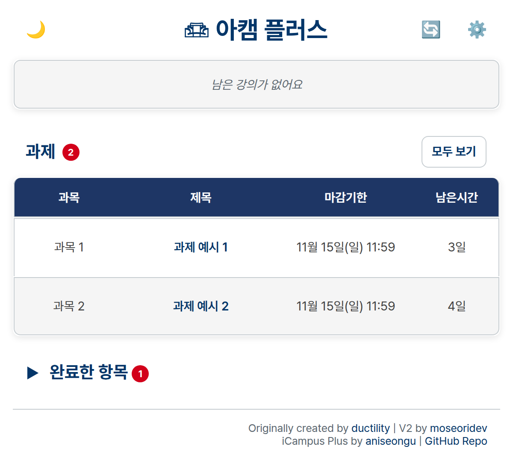
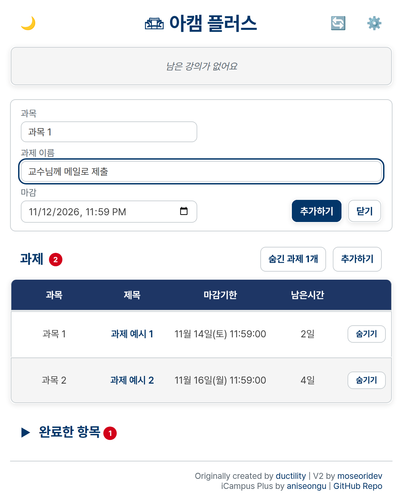
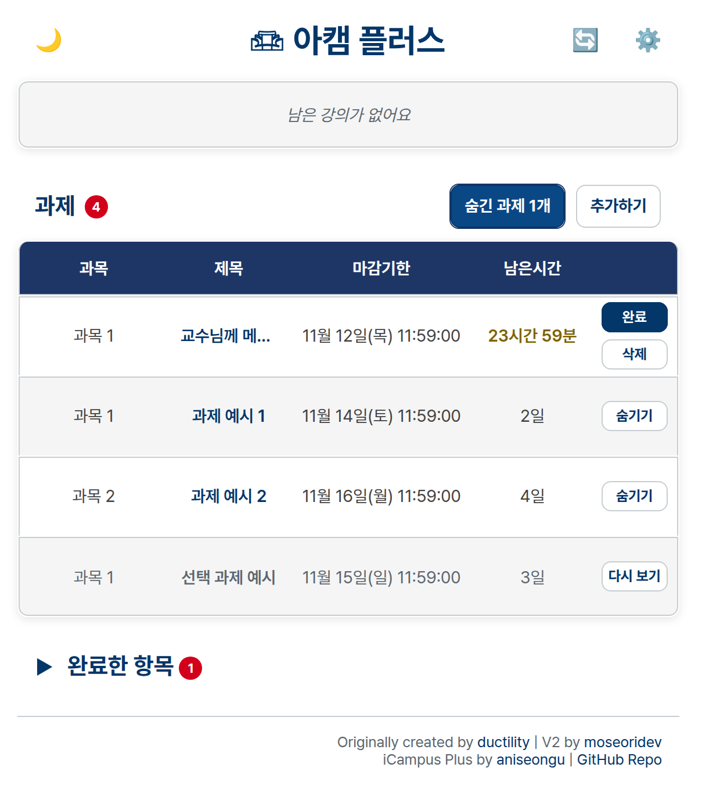
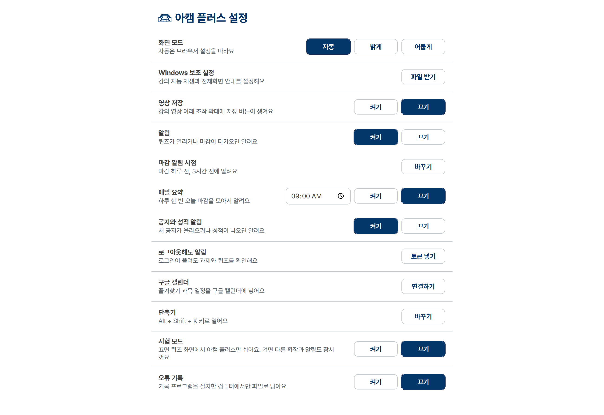
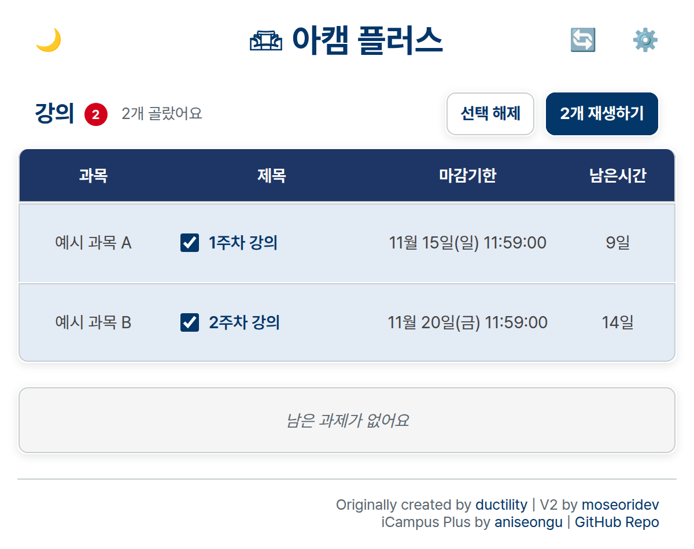
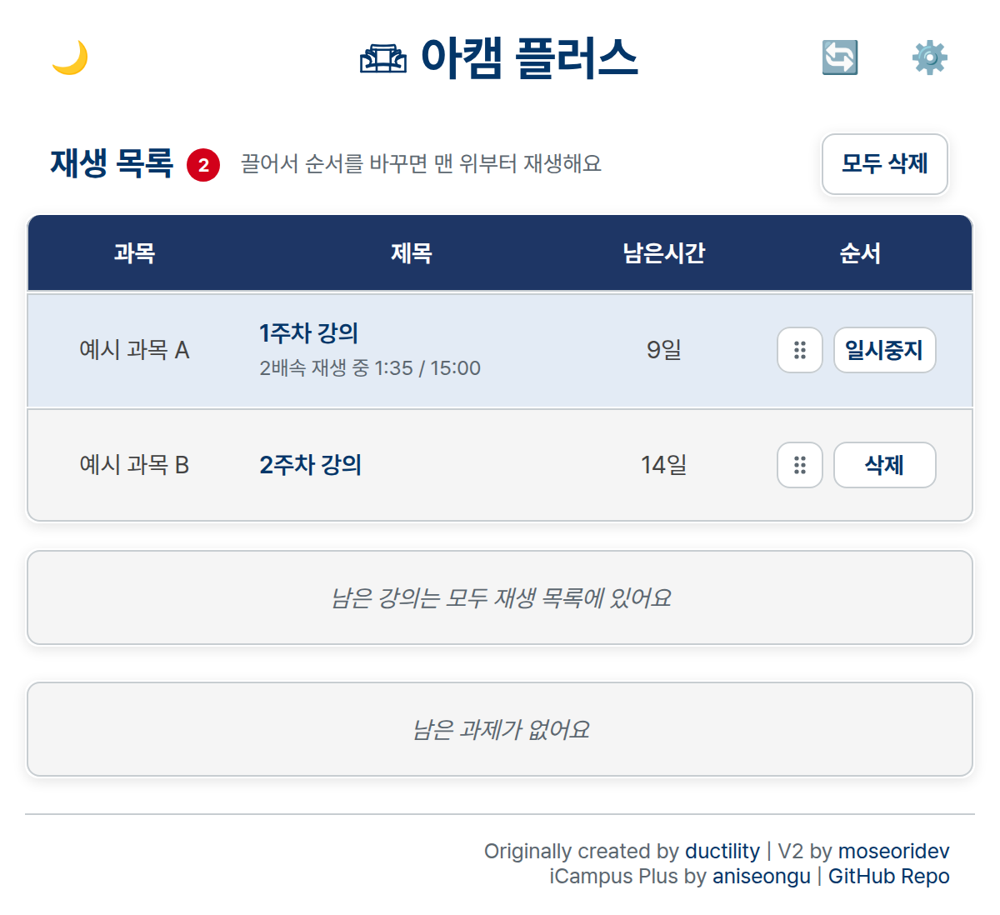
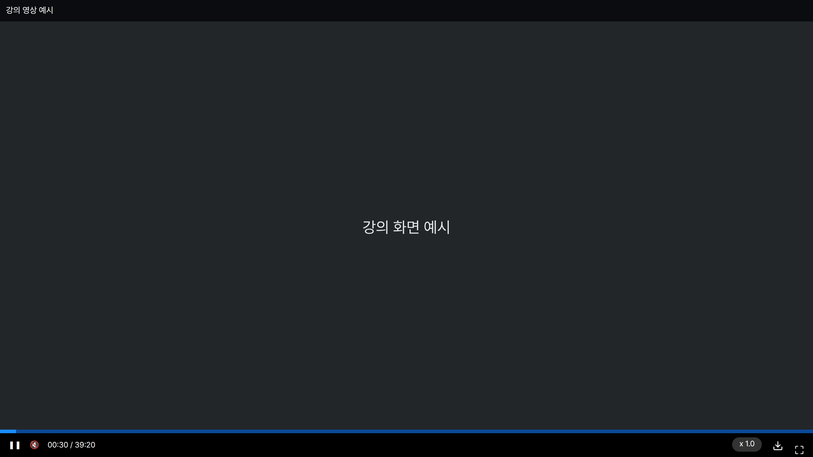
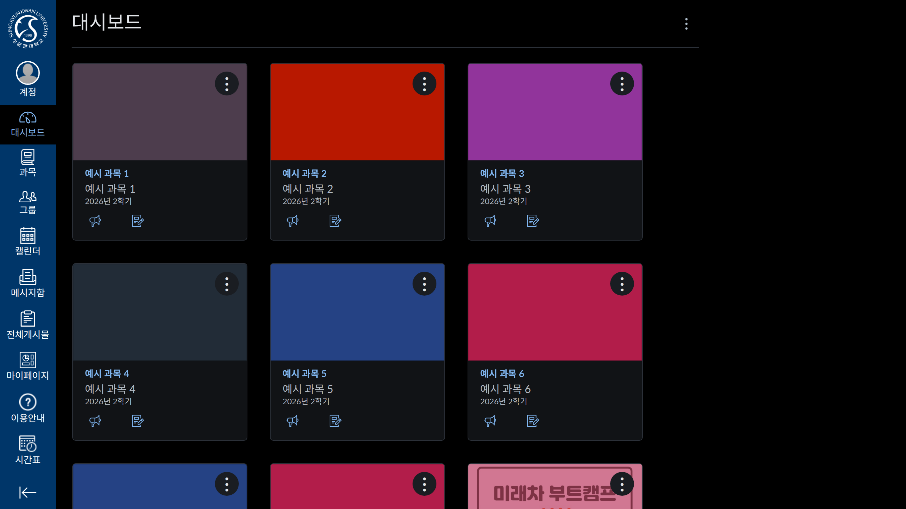
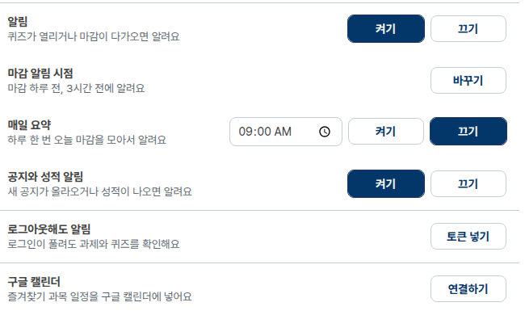
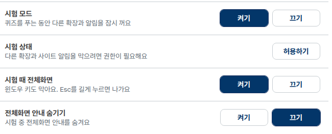

<div align="center">


# 아캠 플러스

성균관대 아이캠퍼스의 남은 과제와 강의를 모아 보고, 화면을 편하게 읽도록 돕는 브라우저 확장

[](https://chromewebstore.google.com/detail/%EC%95%84%EC%BA%A0-%ED%94%8C%EB%9F%AC%EC%8A%A4/dfbmennlapdcfamcdocebolgclgibmmn)


</div>

아캠 플러스는 크로미움 기반 브라우저용 Manifest V3 확장입니다. Windows의 크롬과 웨일에서 설치와 주요 동작을 확인했고, 맥과 리눅스의 크롬 계열 브라우저에서도 쓸 수 있습니다. 맥과 리눅스는 자동 테스트(GitHub의 macOS·Linux 환경, 리눅스 크로미움에서 실제 강의 재생과 영상 저장)로 확인했습니다. 다른 크로미움 브라우저의 동작은 환경에 따라 다를 수 있습니다.

## 주요 기능

- **할 일과 재생 목록:** 즐겨찾기 과목의 과제와 LearningX 강의를 마감 순으로 보여 줍니다. 강의를 골라 순서를 바꿀 수 있고, 재생 목록에서는 자동 재생과 다음 강의 이동을 시도합니다.
- **과제 정리:** 안 내도 되는 과제는 행에서 숨기고, 메일처럼 아이캠퍼스 밖에서 내는 과제는 직접 추가할 수 있어요. 숨긴 과제는 알림과 캘린더에서도 빠지고, 직접 추가한 과제는 마감 알림을 받아요. 둘 다 이 브라우저에만 저장돼요.
- **알림과 캘린더:** 퀴즈 열림, 마감, 새 공지와 성적 공개를 알려 줍니다. 원하는 경우 구글 캘린더에도 마감 일정을 맞춥니다.
- **읽기 편한 화면:** Canvas와 LearningX의 다크 모드, 좁은 창의 영상·PDF 확대, 메시지함의 일반 메시지와 학습 알림 나눠 보기를 제공합니다.
- **강의콘텐츠 주차:** 처음 열면 현재 남은 항목이 있는 주차를 먼저 펼치고, 없으면 가장 최근 공개된 주차를 보여 줍니다. 직접 고른 주차는 그대로 볼 수 있습니다.
- **강의 영상:** 영상 앞의 인트로·프리로더를 건너뛰고, 학교 플레이어의 전체화면 버튼으로 좁은 창에서도 영상을 크게 볼 수 있습니다.
- **선택 기능:** 영상 저장, 로그아웃 중 일정 알림과 시험 모드의 세부 기능을 설정에서 선택할 수 있습니다.

## 기능 화면

### 남은 과제

팝업에서 즐겨찾기 과목의 남은 과제와 마감까지 남은 시간을 확인할 수 있습니다. 과목명과 과제명은 예시로 바꿨습니다.



### 과제 숨기기와 직접 추가

안 내도 되는 과제는 **숨기기**로 목록과 알림에서 뺄 수 있고, 제목 줄의 **숨긴 과제 N개**로 다시 볼 수 있습니다. 메일처럼 아이캠퍼스 밖에서 내는 과제는 **추가하기**에서 과목, 이름, 마감을 적어 직접 추가하면 마감 알림도 받습니다.





### 설정

자주 쓰는 설정부터 화면 모드, 보조 설정, 영상 저장, 알림 순서로 모았습니다. 맥과 리눅스에서는 Windows 보조 설정 대신 강의 자동 재생 스크립트 받기 줄이 보입니다.



### 강의 선택과 재생 목록

강의를 고른 뒤 재생 목록으로 듣고, 목록에서 순서를 바꾸거나 일시중지할 수 있습니다. 재생 목록으로 연 강의는 자동 재생을 시도하고, 완료 화면을 확인한 뒤 다음 강의로 넘어갑니다. 아래 강의 이름과 재생 상태는 화면 예시입니다.





### 인트로 건너뛰기, 영상 확대, 영상 저장

영상 앞의 인트로·프리로더를 자동으로 넘깁니다. 일반 브라우저 창에서 학교 플레이어의 전체화면 버튼을 누르면 영상이 창 안에서 크게 펼쳐집니다. 설정에서 영상 저장을 켜면 전체화면 버튼 옆에 다운로드 버튼이 생깁니다(아래 화면은 예시 영상입니다).



### 화면 모드

Canvas와 LearningX에서 밝은 화면과 어두운 화면을 고를 수 있습니다.



### 알림과 구글 캘린더

마감 알림 시점과 매일 요약을 고르고, 원하는 경우 구글 캘린더를 연결할 수 있습니다.



### 시험 모드

시험 모드를 켜면 시험 중 다른 확장과 알림을 잠시 멈추는 기능, 전체화면 관련 선택 기능을 설정할 수 있습니다. 시험 모드가 꺼져 있어도 퀴즈 응시 화면에서는 아캠 플러스의 모든 기능이 멈춥니다.



## 기술 구성


| 구분 | 사용 기술 |
| --- | --- |
| 언어 | JavaScript, HTML, CSS |
| 확장 구조 | Manifest V3, 서비스 워커, 콘텐츠 스크립트, Chrome Extensions API |
| 연동 | Canvas·LearningX API, Google Calendar API(선택 기능) |
| 라이브러리 | SortableJS(재생 목록 정렬) |

## 설치와 업데이트

크롬은 [Chrome 웹 스토어](https://chromewebstore.google.com/detail/%EC%95%84%EC%BA%A0-%ED%94%8C%EB%9F%AC%EC%8A%A4/dfbmennlapdcfamcdocebolgclgibmmn)에서 바로 설치할 수 있습니다. 웨일 등 다른 크로미움 브라우저나 최신 소스를 쓰려면 이 저장소를 내려받아 확장 폴더를 직접 불러옵니다.

1. [저장소](https://github.com/aniseongu/icampus-plus)에서 **Code > Download ZIP**을 눌러 압축을 풉니다. Git을 쓴다면 `git clone https://github.com/aniseongu/icampus-plus.git`도 됩니다.
2. 크롬은 `chrome://extensions`, 웨일은 `whale://extensions`를 열고 **개발자 모드**를 켭니다. 다른 크로미움 브라우저에서는 해당 브라우저의 확장 관리 화면을 여세요.
3. **압축 해제된 확장 프로그램을 로드**를 눌러 `manifest.json`이 있는 폴더를 고릅니다.

업데이트할 때는 같은 폴더에 새 파일을 덮어쓰고 확장 관리 화면에서 **새로고침**을 누르세요. 폴더를 옮기면 브라우저가 새 확장으로 인식해 설정이 초기화될 수 있습니다. 웹 스토어판과 직접 불러온 판을 함께 쓰고 있다면 한쪽을 꺼 두세요.

## 시작하기

1. [아이캠퍼스](https://canvas.skku.edu)에 로그인합니다.
2. **과목 > 모든 과목**에서 보고 싶은 과목에 별표를 붙입니다.
3. 툴바의 아캠 플러스 아이콘이나 `Alt + Shift + K`로 팝업을 엽니다. 오른쪽 위 톱니 버튼에서 설정을 엽니다.
4. 강의 표에서 들을 강의를 고르고 **재생하기**를 누릅니다. 강의를 끌어 순서를 바꾸거나 일시중지할 수 있습니다.

시험 모드는 기본으로 꺼져 있습니다. 시험 모드를 꺼 둬도 퀴즈 응시 화면에서는 아캠 플러스의 모든 기능이 멈추고, 켜면 다른 확장 끄기와 전체화면 같은 시험용 설정이 적용됩니다. 실제 시험 전에 학교의 시험 요구 사항과 확장 동작을 확인하세요.

## 브라우저별 다크 모드

아이캠퍼스 화면은 아캠 플러스가 직접 색을 입힙니다. 브라우저의 강제 다크 모드까지 아이캠퍼스에 적용하면 색이 다시 바뀔 수 있습니다.

| 환경 | 설정 방법 |
| --- | --- |
| **크롬 등** | 브라우저의 강제 다크 모드를 따로 켰다면 아이캠퍼스에는 적용하지 않도록 해 주세요. |
| **웨일** | 웹 콘텐츠 다크 모드를 사용한다면 **사이트 제외**에서 `canvas.skku.edu`를 제외하세요. 확장 설정 화면의 색이 다시 바뀐다면 **웨일 확장 화면 보정**을 켜 주세요. |

화면 모드의 **자동/밝게/어둡게**는 브라우저와 관계없이 고를 수 있습니다. 웨일의 웹 콘텐츠 다크 모드를 사용하지 않거나 확장 자체를 예외에 넣었다면 설정 탭의 웨일 보정을 꺼도 됩니다. 툴바 팝업은 웨일이 예외와 관계없이 다시 칠할 수 있어 항상 보정합니다.

## 선택 기능

- **알림:** 기본으로 1시간마다 일정을 확인합니다. 마감 알림 시점과 매일 요약은 설정에서 고를 수 있습니다. 로그아웃 중에도 과제·퀴즈 알림을 받으려면 내 Canvas 액세스 토큰을 설정에 넣으세요. 토큰은 계정 전체 권한을 가지므로 짧은 만료일을 정하고, 필요 없어지면 설정과 아이캠퍼스에서 지우세요.
- **구글 캘린더:** 내 구글 계정의 아캠 플러스 캘린더에 즐겨찾기 과목의 마감 일정을 맞춥니다. 아래 연결 방법을 참고하세요.
- **영상 저장:** 설정에서 켜면 강의 플레이어의 다운로드 버튼이 나타납니다. 개인 학습용으로만 사용하고 다른 사람에게 나누거나 올리지 마세요.
- **시험 모드:** 기본은 꺼짐이며, 꺼져 있어도 퀴즈 응시 화면에서는 아캠 플러스 기능이 멈춥니다. 설정에서 켜면 시험 화면에서 다른 확장·사이트 알림도 잠시 멈춥니다. 감독용 확장은 설정의 **시험 중에도 켤 확장**에서 고를 수 있습니다. 모든 확장을 꺼야 하는 시험이라면 아캠 플러스도 확장 관리 화면에서 직접 끄세요.
- **전체화면 안내 숨기기:** Windows x64에서 사용할 수 있는 실험적 선택 기능입니다. 설정의 **Windows 보조 설정 > 파일 받기**를 누르고 받은 파일을 열어 브라우저를 고른 뒤 **전체화면 보조 설치**를 누르세요. 확장 설정에서 전체화면 안내 숨기기를 켜고 권한을 허용하면 연결합니다. 다른 브라우저를 쓰면 각각 설치해 주세요. [제한과 제거 방법](native/fullscreen-prototype/README.md)을 확인하세요.

### 구글 캘린더 연결

별도 중계 서버 없이 브라우저에서 내 구글 캘린더로 직접 일정을 보냅니다. 처음 연결할 때 내 Google Cloud OAuth 클라이언트가 필요합니다.

1. [Google Cloud 콘솔](https://console.cloud.google.com/)에서 프로젝트를 만들고 **Google Calendar API**를 켭니다.
2. **Google 인증 플랫폼**에서 동의 화면을 만듭니다. 학교 계정으로 만든 프로젝트라면 **내부**, 개인 계정이라면 **외부**를 고릅니다. 외부 테스트 상태는 7일마다 연결이 끊길 수 있으므로, 계속 쓰려면 내 계정을 테스트 사용자로 넣고 앱을 프로덕션으로 바꿉니다.
3. **웹 애플리케이션** 유형의 OAuth 클라이언트를 만들고 승인된 리디렉션 URI에 `https://<확장 ID>.chromiumapp.org/`를 넣습니다. ID는 확장 관리 화면에서 확인할 수 있습니다.
4. 아캠 플러스 설정의 **구글 캘린더 > 연결하기**에 클라이언트 ID를 넣습니다. 연결을 계속 유지하려면 같은 클라이언트의 보안 비밀번호도 넣으세요. 구글 로그인 창에서 허용하면 연결됩니다.

확장 폴더를 옮겨 ID가 바뀌면 리디렉션 URI도 바꿔야 합니다. **연결 해제**는 맞추기를 멈추며, 만든 캘린더는 구글 캘린더에서 따로 지울 수 있습니다.

### 강의 자동 재생

브라우저가 소리 켠 영상의 자동 재생을 막으면 강의 화면을 한 번 눌러 주세요. Windows x64에서는 설정의 **Windows 보조 설정 > 파일 받기**를 누르고 받은 파일에서 브라우저를 고른 뒤 **강의 자동 재생 허용**을 누를 수 있어요. 브라우저를 다시 열면 적용돼요. 이 설정은 아이캠퍼스와 강의 영상 사이트를 브라우저의 자동 재생 허용 목록에 추가하며, 브라우저에 **조직에서 관리** 표시가 생길 수 있어요. 같은 파일에서 **자동 재생 설정 되돌리기**를 누르면 이 프로그램이 추가한 항목만 지웁니다.

### 맥과 리눅스 자동 재생

맥과 리눅스에서도 강의 화면을 한 번 누르면 재생돼요. 누르지 않고 재생하려면 터미널에서 허용 목록 정책을 켜면 돼요. 프로그램 설치 없이 파일 하나면 돼요. 설정의 **강의 자동 재생 > 파일 받기**로 `icampus-autoplay.sh`를 받아 받은 폴더에서 실행하세요. 스토어에서 설치했다면 [이 저장소의 파일](https://github.com/aniseongu/icampus-plus/blob/master/native/unix-autoplay/icampus-autoplay.sh)에서 오른쪽 위 다운로드(Raw) 버튼으로 받으세요.

```bash
sudo bash icampus-autoplay.sh install    # 설치된 크롬, 크로미움, 엣지, 브레이브에 허용
sudo bash icampus-autoplay.sh status     # 허용 여부 확인
sudo bash icampus-autoplay.sh uninstall  # 이 스크립트가 추가한 설정만 지우기
```

브라우저를 완전히 닫았다가 다시 열면 적용돼요. 리눅스는 `/etc/.../policies/managed/icampus-plus-autoplay.json` 파일 하나를, 맥은 `/Library/Managed Preferences/`의 브라우저 plist 파일에 `AutoplayAllowlist` 항목 하나를 쓰고 아이캠퍼스와 강의 영상 주소 두 곳만 넣어요. 적용되면 브라우저 주소창에 `chrome://policy`를 열어 확인할 수 있고, 브라우저에 **조직에서 관리** 표시가 생길 수 있어요. 맥은 GitHub의 macOS 환경에서 크롬이 정책을 읽는 것까지 확인했어요.

## 알아둘 점

- 맥과 리눅스의 크롬에서도 과제 보기, 숨기기, 직접 추가, 재생 목록, 영상 저장을 쓸 수 있어요. 시험 모드의 전체화면 고정과 Windows 보조 설정(전체화면 안내 숨기기)은 Windows에서만 보여요. 강의 자동 재생 허용은 맥·리눅스용 스크립트가 따로 있어요.
- 학교의 비공개 LearningX API가 바뀌면 강의 일부를 못 가져올 수 있습니다. 실제 마감 시각과 출석 인정은 아이캠퍼스에서 확인하세요.
- 팝업에 **강의와 과제 …건을 불러오지 못했어요**가 나오면 과목과 자료 종류를 확인하고 [Issues](https://github.com/aniseongu/icampus-plus/issues)에 알려 주세요.
- 권한과 저장 정보는 [개인정보처리방침](PRIVACY.md)에 설명했습니다. 변경 사항은 [커밋 기록](https://github.com/aniseongu/icampus-plus/commits)에서 볼 수 있습니다.

## 출처와 참고

이 확장은 아래 프로젝트들 덕분에 만들 수 있었습니다.

| 프로젝트 | 만든 사람 | 참고한 부분 |
| --- | --- | --- |
| [아캠체크 (iCampus Check)](https://github.com/moseoridev/iCampusCheck) | [ductility](https://github.com/ductility/iCampusCheck), [moseoridev](https://github.com/moseoridev) | 이 확장의 바탕입니다. 팝업 배치, 강의와 과제 표, 과제 수집 구조를 이어받았습니다. |
| [아캠 프리미엄 (iCampus Premium)](https://github.com/kangrnin/icampus-premium) | [kangrnin](https://github.com/kangrnin), [threedalpeng](https://github.com/threedalpeng) | 강의 영상의 인트로 건너뛰기 방식. 코드는 새로 작성했습니다. |
| [아캠 매니저 (iCampus Manager)](https://github.com/again7536/icampus-manager) | [again7536](https://github.com/again7536) | 재생목록에서 강의를 고르고 다음 강의로 넘어가는 방식 |
| [Material UI List](https://mui.com/material-ui/react-list/) | MUI | 재생목록의 체크 상태와 선택 개수 표시 |
| [Lucide](https://lucide.dev) | Lucide 기여자 | 영상 저장 아이콘(download, ISC). |
| [StreamSaver.js](https://github.com/jimmywarting/StreamSaver.js) | jimmywarting | 서비스 워커를 거쳐 큰 파일을 메모리에 올리지 않고 바로 저장하는 방식. 코드는 새로 작성했습니다. |
| [skku-icampus-UIenhancer](https://github.com/SWKHJ/skku-icampus-UIenhancer) | SWKHJ | 대시보드 완료 항목 펼치기와 D-Day 배지 아이디어. 코드는 새로 작성했습니다. |
| [SortableJS](https://github.com/SortableJS/Sortable) | SortableJS 기여자 | 재생 목록 끌어서 순서 바꾸기. 1.15.6을 `vendor/`에 그대로 넣었습니다(MIT). |

### 아이콘

삼성학술정보관 정면 사진 [Samsung Library-Front.jpg](https://commons.wikimedia.org/wiki/File:Samsung_Library-Front.jpg)(Srobidx, [CC BY-SA 4.0](https://creativecommons.org/licenses/by-sa/4.0/))에서 지붕 윤곽을 따서 만들었습니다. 색은 성균관대 상징색인 진녹색(Pantone 3435C, `#124532`)입니다. 아이콘 파일(`icons/`)은 원본 사진의 라이선스에 따라 CC BY-SA 4.0으로 배포합니다.

## 문의

버그나 제안은 [Issues](https://github.com/aniseongu/icampus-plus/issues)에 남겨 주세요. 어떤 화면에서 무엇이 이상했는지 적어 주시면 고치기 쉽습니다.

## 라이선스

원본 아캠체크 저장소에 라이선스가 명시되어 있지 않아, 이 저장소에도 별도 라이선스를 붙이지 않았습니다. 원본 코드의 권리는 원작자에게 있습니다. 아이콘은 위에 적은 대로 CC BY-SA 4.0입니다.
